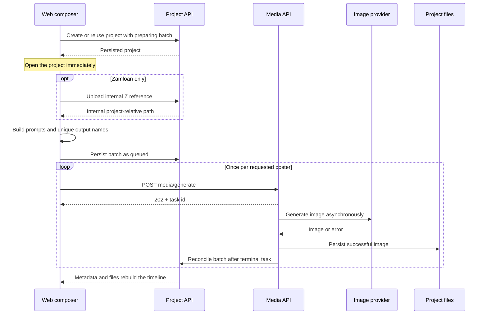
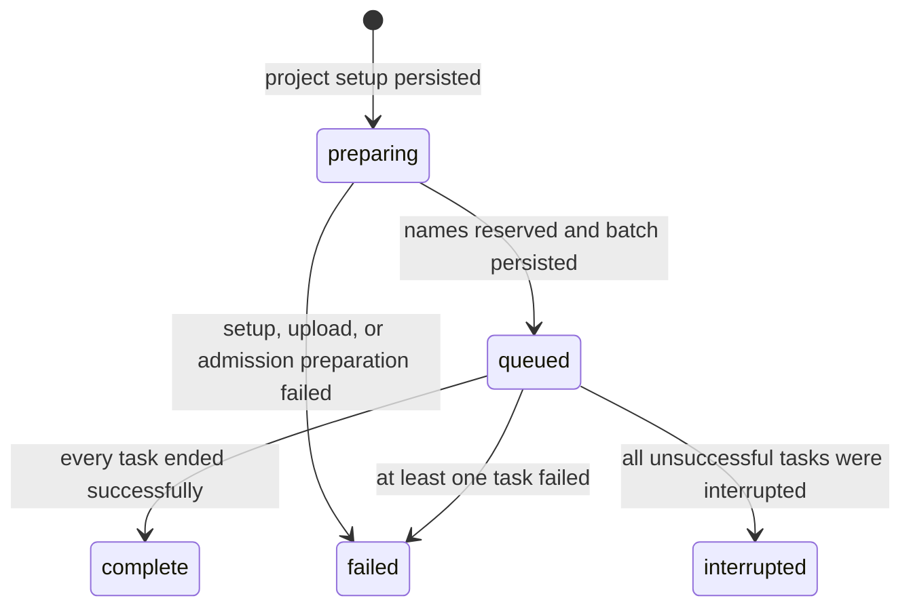

# Loan Poster Workflow Architecture and Invariants

This document records the current production behavior of Niki's one-click
Zambia loan-poster workflow, with emphasis on the Home direct-generation path.
It is a maintenance guide for changes that cross the web UI, shared contracts,
daemon media tasks, persisted project metadata, and generated project files.
It is not a replacement for the product overview in `README.md` or the
creative rules in `skills/loan-poster-skill-v1-1/`.

## Execution paths and scope

Niki currently has two adjacent paths that must not be confused:

- **Home direct generation:** when the Home composer has no manual prompt or
  attachment, its primary action calls `startDirectLoanPosterProject`. This
  path creates/reuses a direct-generation project, records batches, and calls
  the media API without an agent turn. The lifecycle and invariants below
  primarily describe this path.
- **Chat/skill generation:** entering manual content uses the ordinary chat
  submission path. The in-project auto-poster control also builds a skill
  prompt with `buildLoanPosterPrompt` and sends an agent turn. Its creative
  contract lives in `skills/loan-poster-skill-v1-1/`; it does not create the
  direct-generation batch lifecycle described below.

A change to one path does not automatically update the other. Any intentional
unification must define the migration and test both behaviors explicitly.

## User-visible contract

A user selects Zamloan or BiuMoney, chooses `1:1` or `16:9`, and requests
between 1 and 10 posters from the Home one-click action. Niki opens the
destination project immediately and starts one image task per requested poster
without an agent-planning turn. Each Home one-click request creates a distinct
batch in the project timeline. Earlier batches and any completed images remain
visible while a later batch is running or after it fails.

The explicit **New chat** action is the project boundary. Reloads and later
calendar days continue to reuse the last writable direct-generation project;
if that project cannot be updated for the current session, the web falls back
to a new project rather than failing the generation.

## Request and persistence flow



The authoritative orchestration order is:

1. Normalize the count and selected brand/aspect.
2. Reuse the last direct-generation project unless the user started a new
   chat; otherwise create a project with a new `preparing` batch.
3. Publish the project to the UI immediately so slow reference upload and media
   setup do not block navigation.
4. Load and upload the bundled Z reference with `visibility=internal` for
   Zamloan only. BiuMoney must not receive that reference.
5. Build one deterministic scene prompt per output. A stable project seed and
   the next output offset prevent each project or batch from restarting at the
   first creative.
6. Reserve exact output names and persist the batch as `queued` before calling
   the media endpoint.
7. Submit one `POST /api/projects/:id/media/generate` request per prompt. The
   endpoint admits each request asynchronously and returns `202` with a task
   identifier.
8. Persist every task transition. Once all image tasks belonging to the active
   batch are terminal, reconcile the project and batch lifecycle.
9. Rebuild the visible timeline from persisted batch-to-output-name mappings
   and the files that actually exist.

## Data model and state machine

`ProjectMetadata.directGeneration` marks a direct loan-poster project. Its
top-level lifecycle mirrors the active batch for legacy clients, while
`batches` is the ordered history. Each batch stores its stable ID, expected
output count, exact output names, requested/queued/terminal timestamps, brand,
aspect ratio, status, and optional failure detail.



Daemon startup changes persisted `queued` or `running` media tasks to
`interrupted` and then reconciles affected poster projects. The UI also treats
an old active lifecycle with no files as interrupted after its freshness
window, so an abandoned batch does not render an endless spinner. That UI
fallback is presentation recovery; daemon task reconciliation remains the
durable source of lifecycle transitions.

A failed batch may still contain successful images. Those files stay visible
and the batch is presented as incomplete instead of discarding partial work.

## Output ownership and naming

Direct outputs use this form:

```text
<brand>-poster-<YYYYMMDD>-<NNN>.png
```

The sequence advances beyond existing dated files and previously reserved
outputs in the reused project. Names must never overwrite earlier results.
Each persisted batch claims files by exact `outputNames`; prefix matching must
not attach all historical files to the newest batch. Files predating batch
metadata are retained in a separate legacy-history group.

Generated files are the durable delivery evidence. Lifecycle metadata records
intent and progress, but the UI counts and displays the project files that
actually exist. Do not report a poster as delivered solely because a provider
request returned successfully.

## Security and admission boundaries

- Authenticated Niki requests are resolved to a user before project routes run,
  and project-scoped requests must belong to that user. Auth-disabled local
  installs retain the local same-origin restriction for media generation.
- Generation quota is checked by the daemon when each media task is admitted.
  Storage quota is checked for uploads and generated project data at the
  daemon boundary.
- Provider credentials stay in daemon configuration. The web submits only the
  model, aspect, prompt, optional internal reference path, quality, and output
  name through the media API.
- Zamloan's Z reference is an internal input, not a visible deliverable.
  BiuMoney must not upload, pass, or render it.
- Error handling must preserve the failing stage (`create-project`,
  `upload-reference`, or `start-generation`), HTTP status, structured code,
  and useful detail. Authentication failures must not be collapsed into a
  generic media error.

## Non-negotiable maintenance invariants

1. Persist `preparing` before slow setup and persist `queued` before submitting
   provider work.
2. Never leave a rejected or abandoned request represented as an indefinitely
   active batch; record or present a terminal failure/interruption.
3. Keep every Home direct-generation request as a separate ordered batch. New
   work must not replace older results.
4. Keep exact output-name ownership on every batch and preserve unclaimed
   legacy files separately.
5. Treat project files and persisted media tasks as recovery sources; React
   component state alone is never sufficient.
6. Continue to show successful outputs from a partially failed batch.
7. Keep prompt construction deterministic and centralized. Do not duplicate
   brand rules or prompt strings across UI components.
8. Honor the selected brand and aspect end to end. Zamloan alone uses the Z
   reference; neither brand may leak into the other's prompts or outputs.
9. Enforce ownership, generation quota, storage quota, and provider-secret
   boundaries in the daemon, never only in the web UI.
10. Keep the direct path free of an agent-planning round trip. It creates media
    tasks through the shared `/api/*` boundary.
11. Preserve compatibility with legacy skill IDs and pre-batch output names
    unless an explicit migration removes that support.
12. When changing the capability rather than only its presentation, apply the
    repository's UI/CLI dual-track rule and keep both surfaces on the same API
    and contract shapes.

## Code ownership map

| Concern | Source of truth | Primary tests |
| --- | --- | --- |
| Brand, count, aspect, prompt variation, reference policy | `apps/web/src/components/home-hero/zambia-posters.ts` | `apps/web/tests/components/home-hero/zambia-posters.test.ts` |
| Project reuse, batch preparation, output reservation, media submission | `apps/web/src/components/home-hero/direct-loan-posters.ts` | `apps/web/tests/components/home-hero/direct-loan-posters.test.ts` |
| Chat/skill auto-poster submission | `apps/web/src/components/ChatComposer.tsx` | Web composer and prompt tests |
| Shared batch and metadata shapes | `packages/contracts/src/api/projects.ts` | Contract consumers' typechecks and app tests |
| Timeline reconstruction and legacy files | `apps/web/src/components/direct-poster-batches.ts` | `apps/web/tests/components/ChatPane.streaming.test.tsx` |
| Timeline presentation and stale-active fallback | `apps/web/src/components/ChatPane.tsx` | `apps/web/tests/components/ChatPane.streaming.test.tsx` |
| Media admission, quota check, provider dispatch, file/canvas handoff | `apps/daemon/src/media-routes.ts` | Daemon media and route tests |
| Durable media tasks, boot recovery, terminal reconciliation | `apps/daemon/src/media-tasks.ts` | `apps/daemon/tests/media-tasks-persistence.test.ts` |
| Creative-generation contract | `skills/loan-poster-skill-v1-1/` | Skill validation and web prompt tests |

Update the shared contract before changing lifecycle fields consumed by both
apps. Keep web and daemon integration behind HTTP; neither app may import the
other app's private source.

## Validation checklist

Before merging a poster-workflow change:

1. Run the repository baseline checks:

   ```bash
   pnpm guard
   pnpm typecheck
   ```

2. Run at least the affected focused suites:

   ```bash
   pnpm --filter @open-design/web test
   pnpm --filter @open-design/daemon test
   ```

3. Exercise the real UI flow with `pnpm tools-dev`: create a new chat, generate
   both brands, use both aspects, request multiple posters, start a second
   batch, refresh during generation, and confirm old and partial results remain
   addressable.
4. Exercise failure recovery: reject setup or admission, exhaust a configured
   quota, and restart the daemon with active media tasks. Confirm the batch
   becomes actionable failure/interruption UI rather than an endless spinner.
5. Verify the actual runtime URL or desktop instance is backed by the intended
   branch and commit before calling a user-visible change delivered.
